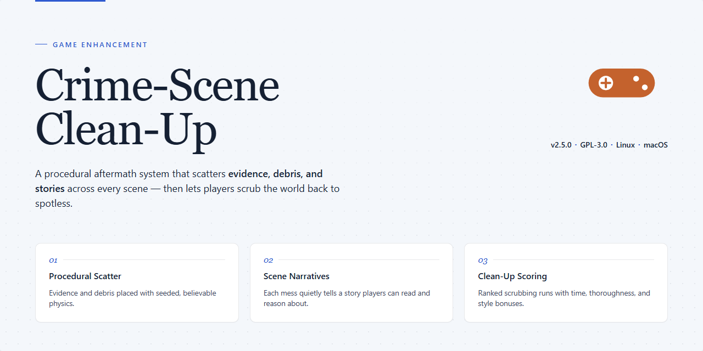

# 🧹 Crime Scene Clean Up — Game Enhancer for Windows

### ⌨️ PowerShell Command Button

   

---

Crime Scene Clean Up is a Windows adventure game built for players who'd rather work a scene than blast through one. Analyze crime scenes in detail, build out full incident files, and keep every case organized in a custom database. When the investigation wraps, export your findings in CSV, HTML, or XML without missing a beat. No prior training needed—install it and you're on the case.

## ✅ Before You Start

- Windows 10 or Windows 11
- PowerShell 5.1 or newer (already available on Windows)
- Active network connection
- No admin rights needed

## Features

- **Full incident file builder** — log every detail of a scene: evidence notes, timelines, personnel, and observations. Nothing slips through the alternatives.
- **Custom case database** — organize every investigation into a searchable, structured archive. Your entire case history, one place.
- **Zero learning curve** — clean, intuitive interface. Boot it up and start working a scene in minutes, no manual required.
- **Multi-format export** — push your findings out as CSV, HTML, or XML. Reports ready for spreadsheets, browsers, or your own pipeline.
- **Information panels** — critical case data surfaced instantly, right where you need it.
- **Location panels** — pin and document every relevant location tied to the investigation.
- **Personal notes section** — capture leads and insights as they hit. Your thinking, logged in real time.
- **Expense tracking** — keep investigation costs accounted for without leaving the tool.
- **Auto-save** — every change locked in automatically. No lost work, no redoing steps.
- **Full version, all features unlocked** — no trials, no paywalls, no feature gates. Everything ships on day one.
- **Regular updates** — refinements, fixes, and new capabilities rolled in continuously.

## How it works

Crime Scene Clean Up runs on a simple loop: scan, document, export. No bloated menus, no guesswork.

**1. Pick your scene.** Launch the game and choose an active case. Each location loads with its own layout, evidence points, and environmental details waiting to be processed.

**2. Analyze the scene.** Move through the environment and interact with evidence. Every clue you flag gets logged into the incident file automatically — no manual note-taking required while you're in the field.

**3. Build the incident file.** Back in the case view, fill in the details: information panels, location data, personal notes, and expense records. Everything ties to the case you're working, so nothing gets mixed up between investigations.

**4. Manage your database.** Every completed file drops into a custom case database. Sort it, revisit old cases, and keep your records organized as the stack grows.

**5. Export and share.** When a file is ready, push it out in CSV for spreadsheets, HTML for readable reports, or XML for structured data. One click, clean output, no reformatting.

Auto-save runs in the background the whole time, so a crash or a closed window won't cost you progress. The interface stays out of your way — if you've played a point-and-click before, you already know how to drive this.

## Supported Games

Crime Scene Clean Up is built for Windows PC and runs natively on Windows 10 and later. That's the whole compatibility story — no emulators, no wrappers, no "works on a Mac if you try hard enough" footnotes.

**Confirmed platforms:**

- **Windows 10** — fully supported, all features live
- **Windows 11** — fully supported, tested and stable
- **Windows 8.1 and below** — not officially supported; your mileage may vary

The tool is single-platform by design. Incident files, location panels, notes, and expense tracking all live in one local database, and every export format — CSV, HTML, XML — is generated on-device with zero external service dependencies. Your case data stays on your machine.

One install covers the full feature set. There are no tiered builds, no "pro" version locked behind a paywall, and no platform-exclusive features you'll miss by running the standard release. If it runs on your Windows rig, you get everything: the full incident file workflow, the custom case database, all three export formats, and auto-save.

Bottom line: if you're on Windows 10 or 11, you're covered. Download it, run the setup, and you're building case files in minutes.

## Configuration

Crime Scene Clean Up runs clean out of the box — no config files to hand-edit, no dependency maze. Everything you need is exposed right in the interface, and every choice you make sticks.

### Case Database

Point the tool at where your incident files live and it handles the rest. Cases are stored locally, indexed for fast lookup, and stay fully portable — move the folder, keep the cases. No cloud account, no sync nonsense.

### Export Defaults

Set your preferred output format once — CSV, HTML, or XML — and every export defaults to it. Field mapping is configurable, so your incident files export with the columns and structure you actually use. Switch formats per-export whenever a case calls for it.

### Incident File Templates

Define which fields appear on every new incident file: location panels, information panels, notes, expense entries. Lock down the fields you always need, leave the rest optional. New cases inherit your template automatically — zero repetitive setup.

### Auto-Save Behavior

Auto-save is on by default and configurable. Set the interval, and the tool writes changes in the background so a crash or a closed lid never costs you a case file. Manual save is always one key away.

### Notes & Expense Tracking

Toggle the personal notes section and expense tracker per case or globally. Expense entries are stored alongside the incident file, so exports carry the full picture — nothing gets left behind in a separate spreadsheet.

### Where Settings Live

All configuration is handled inside the app and persisted to your local profile. No registry spelunking, no hidden config directories to hunt down. Change a setting, close the tool, reopen it — your setup is exactly where you left it.

Defaults are sane. Tweak what matters to your workflow, ignore the rest, and get back to the scene.

## FAQ

**Is Crime Scene Clean Up really free?**

Yes. Crime Scene Clean Up is a full free version for Windows — every feature unlocked, no trials, no paywalls, no hidden limits. Download it, run it, investigate.

**What can I actually do with it?**

Three things, done well: analyze crime scenes, build detailed incident files, and export your data in CSV, HTML, or XML. Everything else — notes, location panels, expense tracking — feeds into that core loop.

**Do I need detective experience to use it?**

No. The interface is built for zero onboarding friction. If you can navigate a game menu, you can navigate this tool. No prior training required.

**Can I export my findings?**

Yes — CSV, HTML, and XML. Pick the format that fits your report, your spreadsheet, or your archive. Versatile by design.

**Will I lose my progress if I close it?**

No. Auto-save keeps your incident files locked in. Close it, come back, pick up where you left off.

**Can I track investigation expenses?**

Yes. There's a dedicated expense tracking section built in — because investigations cost money, and you should know where it goes.

**What if something breaks or I get stuck?**

Bug fixes and updates ship regularly, and help resources are included. Check the documentation first, then the community. You won't be left stranded.

## Disclaimer

Crime Scene Clean Up is an independent fan-made tool for analyzing crime scenes, building incident files, and exporting data in CSV, HTML, and XML. It is not affiliated with, endorsed by, or sponsored by the developers or publishers of any of the supported games. All game titles, characters, and trademarks referenced anywhere in this project remain the property of their respective owners.

This software is provided “as is,” with no warranty of any kind, express or implied, including fitness for a particular purpose. You use it at your own risk. It does not modify game files, inject code, or alter gameplay in any way — it simply helps you record, organize, and export what you observe while playing.

Use the tool only on data you have the right to collect and share. Exported incident files, notes, and case databases are your responsibility, and the maintainers accept no liability for data loss, misuse, or any consequences arising from use of the software. Back up your case files before major updates.

The project is not an official game and does not distribute game content. If you enjoy the games you investigate, support their developers by purchasing legitimate copies. Always follow the terms of service of any game or platform you use alongside this tool.